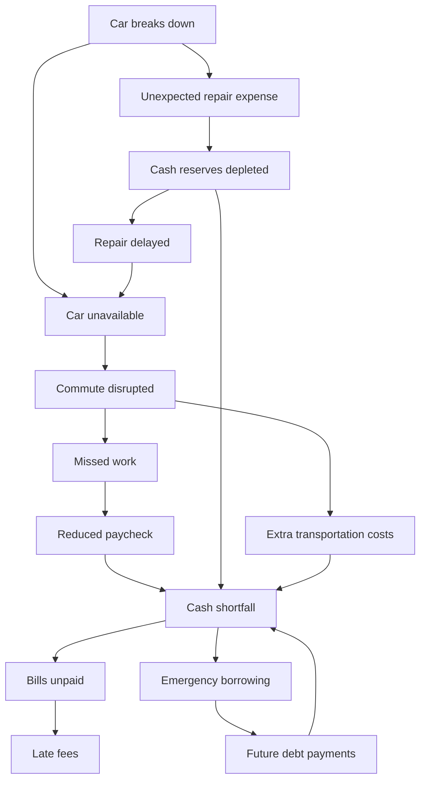

# One Bad Tuesday — Full Product Blueprint

**Status:** Product source of truth for HackTX 2026. This document describes the full intended demo, **not** what Build Sheet 01 should implement.

## 1. The pitch

**One bad day should not become a bad month.** A car breaks down. That prevents a worker from commuting, causes missed shifts, reduces an upcoming paycheck, and cascades into unpaid bills, late fees and potentially expensive borrowing. One Bad Tuesday reconstructs the projected cascade from a synthetic banking profile, **works backward from the bad outcome**, researches real-world interventions, asks high-leverage questions, then combines and tests actions to show a safer alternative future.

**Demo target:** Capital One Nessie (banking simulation/customer data) and SerpApi (evidence-backed local/live research). Gemini supports the agent's hypotheses, tool selection, question generation and narrative explanations. Python—not the LLM—does cash mathematics and plan feasibility.

## 2. Demonstration journey / screens

The team provided a rough four-stage screen flow. Keep the journey recognizable, but design an appealing, coherent experience rather than faithfully reproducing the hand-written layout.

1. **Starter:** customer name, hourly wage input, car-repair quote slider, clear Begin button. The user can play with repair severity. Optional read-only summary of the preset scenario.
2. **Graph + banking context:** watch an untreated consequence graph take shape alongside bank balance, spending categories, future paycheck, and bills with due dates. This is the projected *without-intervention* scenario, not proof that every event has already happened.
3. **Finding a way out:** an animated/realtime-feeling research and solution activity feed; sources and candidates appear, and the agent occasionally asks an important clarifying question. Do not fake real search success; differentiate mock UI in early milestones.
4. **Recommended plan:** 2–3 coordinated plans with expected cash position, protected bills, evidence, assumptions and remaining risks; choosing a plan visually mitigates graph nodes. The customer can change assumptions and recalculate.

## 3. Canonical untreated problem graph

**Problems/consequences only. Never put interventions or decisions inside graph nodes.** Store candidate actions separately, referencing targeted nodes.

The product explores this hypothetical untreated scenario, but **must not assert contradictory financial events as already completed**. In particular, a *repair quote* does not mean the repair was paid; if repair is postponed due to insufficient funds, `cash reserves depleted` must not be attributed to payment of that unpaid repair. Emergency borrowing and late fees are conditional paths based on modeled behavior and terms, not universal facts. Feedback arrows indicate effects over later days, not infinite traversal in one instant. Nodes may be projected, active, mitigated or unresolved; show provenance/assumptions.

## 4. Customer financial model

### Inputs and authoritative sources
- One **synthetic** customer, stored/retrieved through Nessie where the API supports the resource.
- Customer's name, linked checking account(s), current balance, ~90 days of historical purchases with merchants/categories, deposits, known bills/upcoming obligations.
- User-entered hourly wage `r`; assume 40 hours/week, five 8-hour shifts/week, paid weekly. An example take-home multiplier `alpha=0.80` may be configurable **and must be labeled an estimate**, not an actual tax rate. If historical deposits offer a defensible multiplier, use them.
- Customer's home/work locations and shift schedule will eventually be needed for viable transportation research. Use **fictional demo addresses** that correspond to real routing geography; don't hardcode personal real-world addresses.
- Scenario: breakdown timestamp, repair quote (slider), number/timing of threatened shifts, repair availability/price/payment timing, upcoming due dates.

### Core math

- Gross weekly income: `40*r`.
- Gross per shift: `8*r`.
- Estimated take-home income lost if `m` shifts missed: `8*r*m*alpha`.
- Category monthly history average: `(sum of last ~90 days of transactions in category)/3` (or explicitly date-normalized if coverage differs).
- Baseline dated cash flow: `B(t) = B0 + Σ_{d<=t} deposits(d) - Σ_{d<=t} outflows(d)`.
- Crisis cash flow: baseline plus negative effects for wages lost on affected payday and actual crisis costs on their occurrence dates.
- Plan cash flow: `B_plan(t) = B_crisis(t) + Σ_{actions a} Σ_{d<=t} Δ_a(d)`; deduplicate shared outcomes. Preserving a missed shift **removes its lost-wage event**, not an extra wage credit.
- Peak shortfall: `max(0, -min_t B_plan(t))` over the chosen horizon.
- Essential bills unpaid: amount of essential commitments that **cannot be funded when due**, computed from a consistent scheduled-payment simulation rather than just end-of-month balance.
- Only count actual avoided *future* spending as budget savings; historical spending averages only identify candidates.
- Deferred bills remain obligations; borrowing carries dated repayment amounts, including any finance charges where verified.

Represent money in integer cents or Decimal; not binary floating-point. Attach explicit dates and timezone to schedules. Do not double-count historical recorded transactions, seeded scheduled expenses, and recurring bills.

## 5. Research-and-plan agent

### Inputs
Customer financial snapshot, existing problem graph, crisis scenario, upcoming shifts/due dates, user answers, cached research.

### Bounded agent loop
1. **Simulate untreated case** to quantify projected financial harm and identify which graph nodes are implicated.
2. **Trace backward** from `bills_unpaid` through relevant upstream nodes and rank intervention targets using a light heuristic: impact × urgency × actionability (1–3 each). These scores only allocate search budget—not financial outcomes.
3. **Hypothesize interventions** (LLM): protect the commute, retain shifts through employer flexibility, find realistic repair choices, preserve near-term cash, request payment flexibility, investigate assistance, etc. Avoid generic advice.
4. **Research with SerpApi** (backend tools only): Google Search, Google Maps places, and directions/transit when available; preserve source URLs and retrieval time, distinguish a discovered listing from proven pricing, availability or approval. Budget roughly six searches initially.
5. **Normalize candidate actions** to typed records: `id`, title, `targets[]`, `requirements[]` with verified/unknown/false statuses, dated money effects, modeled graph effects, time to execute, evidence links, cost uncertainty, and source provenance.
6. **Ask only decision-changing questions:** e.g. permission to work remotely, another available vehicle, shift time, mechanic payment terms. Prefer research over asking when outside data can answer. Ask at most two in a round. Do not treat unconfirmed employer/merchant decisions as verified.
7. **Enumerate combinations** of up to three actions. Eight candidates give `C(8,1)+C(8,2)+C(8,3)=92` combinations. Reject impossible prerequisites, label unknown prerequisites as conditional.
8. **Simulate each feasible/conditional plan forward** across cash and graph states; preserve temporal order and avoid duplicate benefits; measure essential bills protected, peak shortfall, future repayments, uncertainty and execution complexity.
9. **Rank plans lexicographically:** feasibility first, then essential bills protected, smallest peak shortfall, overall cash/future obligation cost, fewer uncertainties/difficult steps. Show 2–3 distinct plans rather than near-identical combinations.
10. **Replan only for remaining critical problems** for at most one additional bounded research round. Cache prior findings and avoid redundant calls. When customer changes quote or wages, recalculate first; research only if relevant facts changed.

### Question heuristic
`QuestionPriority = decision_impact × uncertainty × relevance_to_top_plans` (illustrative 1–3 scales). Do not request information that won't change a plan.

### LLM-versus-code boundary
Gemini: idea generation, tool selection, evidence interpretation, clarification questions, explanations. Python: money, due-date logic, feasibility, action effects, graph traversal, combinations, ranking. React Flow: problem graph visualization. Never have Gemini invent numerical plan outcomes or claims of verified assistance.

## 6. Suggested implementation stack
- **Frontend:** existing Next.js + TypeScript project, React Flow for graph when its milestone begins, concise UI components, responsive design and loading/error/empty states.
- **Backend:** FastAPI / Python, typed schemas (Pydantic), environment-loaded secrets, HTTP client for Nessie and SerpApi, official supported Gemini SDK for the LLM stage.
- **Persistence:** for 24-hour demo, use deterministic fixtures and local seed-manifest storage, or minimal database *only if warranted*. Nessie remains the external banking-sandbox source for customer records; don't build a large auth or data platform.
- **Tests:** customer transformation/seed idempotency, financial arithmetic and date cases, action combination cases, backend API contracts, frontend happy path.

## 7. Milestones and responsibilities
- **Build Sheet 01 — Starter UI + Customer Data:** end-to-end screens as honest placeholders, functional input controls, one repeatable Nessie-backed synthetic customer profile, normalization, history/categories/balance/bills/weekly-income preview. **No live agent/recommendations yet.**
- **Build Sheet 02 — Financial Crisis Engine + Graph:** dated forecast, missed shift loss, repair quote handling, untreated graph status, graph animation and financial shortfall explanation.
- **Build Sheet 03 — SerpApi + Gemini Research:** bounded tool interface, source collection, candidate extraction, question UI and verification labels.
- **Build Sheet 04 — Planning + Demo Polish:** combinations, constraints, rerun cash-flow, intervention visualizations, dynamic quote scenarios, test fixtures, coherent pitch.

Only Sheet 01 is authorized by the accompanying Codex prompt.

## 8. Demo truthfulness & safety
The app is a **prototype using synthetic finances**; label financial estimates and conditional interventions. Never claim a place is available, a program will approve someone, a price is confirmed, or a bill extension is granted unless the evidence supports it. Do not make real-world bill payments or borrow money. Keys live only in backend environment variables and never in source control, screenshots, client code or logs.

## 9. Success criteria for the entire project
In an understandable live walkthrough, a judge can: enter a name/hourly wage, adjust repair quote, see the authentic synthetic banking context, understand why missed work threatens bills, watch evidence-backed intervention investigation, answer a consequential question, compare feasible conditional plans, and see a clear changed financial forecast and mitigated/unresolved problem graph.

## Reference links
- Nessie docs: https://prod.nessieisreal.com/docs
- Gemini API setup: https://ai.google.dev/gemini-api/docs/get-started
- SerpApi docs: https://serpapi.com/search-api
