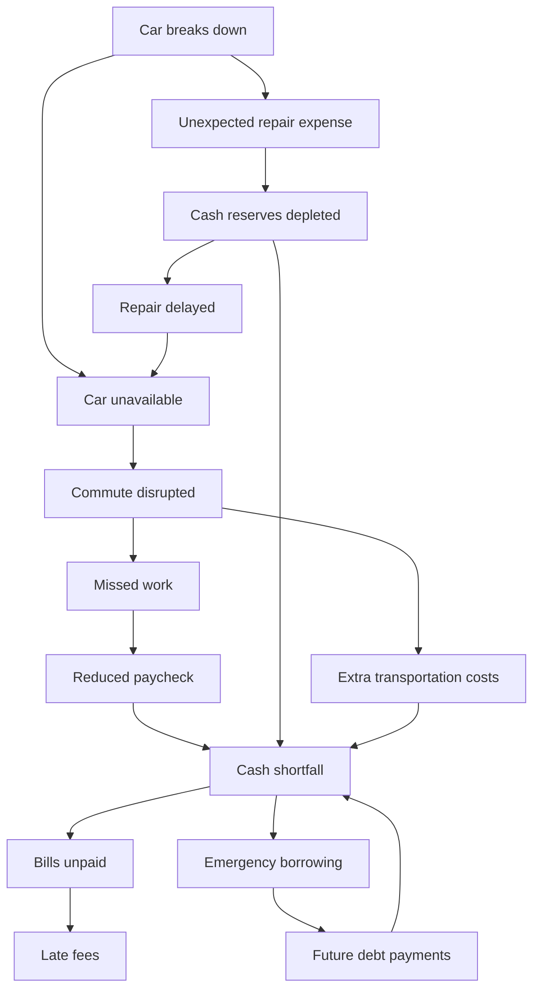

# Build Sheet 02 — Crisis Simulation & Consequence Graph

**Project:** One Bad Tuesday (working title)  
**Milestone:** M2  
**Scope:** Deterministic car-breakdown crisis scenario, dated cash-flow simulation, problem-only consequence graph, and live UI visualization  
**Out of scope:** Gemini reasoning, SerpApi searching, clarification questions, interventions, plan ranking, actual bill-payment execution

## 0. Read this first

Read the repository's current `README.md`, `AGENTS.md`, `docs/PROJECT_BRIEF.md` / project blueprint (where present), Build Sheet 01, customer data models, Nessie adapter, frontend architecture, and tests. **Treat the implementation already present as the starting point**. Do not replace working data contracts or bootstrap the repo again.

Build Sheet 01 should already provide one synthetic customer, a Nessie-backed current account balance, 90 days of transactions, spending categories, upcoming bill schedule, projected paydays, and a baseline cash-flow forecast. Verify these actually exist. If anything essential is missing, identify the gap and implement the smallest compatibility fix; report any significant missing prerequisite instead of inventing live banking data.

**Goal:** The user changes hourly pay / repair estimate, clicks **Simulate Crisis**, sees the untreated future (missed shifts → reduced paycheck → cash shortage → bills at risk/unpaid) build across the graph, and compares **normal vs crisis balances** on a dated timeline. Everything must originate from the customer's real retrieved Nessie banking state plus explicitly identified synthetic scenario assumptions.

## 1. Product principles / locked decisions

1. The graph represents **problems and cascading consequences, never actions or solutions**. Do not insert transit, payment plans, loans-as-solutions, or suggested interventions as graph nodes.
2. Graph is the **projected untreated scenario**: we deliberately seed circumstances in which a car breakdown cascades toward unaffordable bills. These are forecasts, not claims of events that have already happened.
3. Work **forward to simulate the disaster** in M2. Later, the agent will work **backward from unpaid bills** to find intervention points. Do not build the agent yet.
4. Financial math is **deterministic** and independent of the React graph rendering. A single reusable `simulate(profile, scenario, actions=[])`-style engine must eventually support both the untreated future and later intervention combinations. For M2, pass no actions; keep extension points small and documented without implementing hypothetical solution behavior.
5. **The repair quote is not a completed payment.** Do not debit checking or create Nessie transactions merely because the user moves a repair slider.
6. **Historical Nessie records are not mutated** by changing sliders, running simulations, or reloading the page. Baseline and crisis projections are computed locally/server-side from live-read financial snapshots and projected schedules.
7. Monthly spending averages are descriptive. Never debit `average monthly dining / 30` each day if specific forecasted payments are already included. Distinguish booked transactions, scheduled payments, and estimates.
8. No double-counting preserved/lost earnings, rent, transportation, or repair payments. Paycheck loss is applied **when the affected paycheck would arrive**, not as an instant debit on breakdown day.
9. Feedback edges such as repair delayed → car remains unavailable are **time-dependent**; no recursive graph execution or infinite loops.
10. Be honest about what is **projected**, **conditional**, **confirmed from Nessie**, and **actually paid**.

## 2. Authoritative graph

Use stable node IDs and this core structure (labels may be improved for UI clarity):

**Important adjustment for truthful scenario modeling:** This is the *catalog of potential problem dependencies*, not a requirement to assert all 14 nodes are simultaneously realized. The main missed-shift → reduced-pay → shortfall → missed-bill chain is the demo's intentionally projected untreated path. Other branch nodes follow scenario-specific conditions:

- `unexpected_repair_expense`: quote/obligation exists, but not yet paid.
- `cash_reserves_depleted`: active **only if** the simulated scenario includes an actual outflow/depletion. Otherwise dormant/conditional; a quote alone does not drain funds.
- `repair_delayed`: projected active if funds insufficient / repair intentionally postponed; the car remains unavailable during that time.
- `extra_transportation_costs`: active **only if** the scenario includes paid alternative transport. M2 default can be $0 / inactive, since default untreated commuting involves missed work rather than successful transit.
- `emergency_borrowing` and `future_debt_payments`: do not automatically assert loan creation. Default both inactive/conditional. If optional demo scenario explicitly models borrowing, include dated cash inflow and later repayment. Do not invent an actual Nessie loan.
- `late_fees`: active only when bill due-date rules and a known configured late-fee schedule trigger the fee. Defaults may be "unknown / not projected" rather than invented values.
- `bills_unpaid`: forecasted failure to fund one or more required essential bills by their due dates; never claim the bill was actually delinquent or posted in Nessie.

Give each node `id`, `label`, `description`, `status`, `activation_date` (if applicable), `evidence`/calculation details, `amount` (where meaningful), and `source` (Nessie vs scenario assumption vs projection). Suggested statuses: `projected`, `conditional`, `inactive`, `unresolved`; frontend should distinguish these clearly. Edges can optionally carry concise conditions (e.g., "if repair paid", "if borrowing used"). Stable edges preserve the structure even if a branch is not active.

**For the demo's main story**, choose a coherent setup where, absent intervention, the customer misses two eight-hour shifts and a near-term essential bill is unaffordable. Make the reasons and amount transparent. If the real Nessie snapshot/schedule doesn't generate a shortfall, **do not fabricate one**. Instead clearly show the actual result and allow a labeled demo scenario/profile fixture that reliably exhibits one. Never tamper with the live bank balance to force a narrative.

## 3. Inputs and scenario definition

From Build 01:
- Nessie customer ID / account ID, live-read checking balance, source timestamp.
- Dated upcoming essential/discretionary obligations; each has amount, due date, status, payment treatment, unique ID, source.
- Dated upcoming paycheck forecasts, pay-cycle coverage, weekly gross/net calculations.
- Historical 90-day transactions and spending summaries (for context; not as blind daily debits).
- Editable hourly wage `r` (USD/hour), customer name.

New scenario state:
- `scenario_start_date` (use an explicitly selected local calendar date; default today in project/customer timezone).
- `repair_quote` (slider, e.g., $100–$1,500, with sensible increments).
- `affected_shifts`: default 2 eight-hour shifts, scheduled on explicit workdays in the relevant workweek; editable in advanced controls if easy.
- `hours_per_shift = 8`, `weekly_hours = 40`, default Mon–Fri.
- `take_home_multiplier = 0.80` until there is a better explicit/observed estimate. Label this assumption.
- `repair_payment_status = unpaid/deferred` by default; do **not** debit quote.
- `repair_delay_days` or explicit expected car-availability window; may use a simple documented assumption for graph display. Do not use delay as automatic extra missed shifts without scheduling them.
- `transport_costs`: $0 in the untreated default unless an explicit cost is actually incurred. If supported as an advanced scenario input, include payment dates and clarify it doesn't automatically preserve shifts.
- `borrowed_amount`: default $0; disable/unmodeled in base path.
- `forecast_horizon_days`: 30 (maybe 45 if required to show effects through repayment; defaults 30).

**Dates/payroll:** A missed shift only reduces the paycheck associated with the pay period containing that shift. Reuse the Build 01 payday logic; ensure pay periods are explicit. If the existing forecast doesn't include shift coverage, introduce a simple documented weekly pay-period mapping (e.g., Mon–Sun worked, following Friday paid) and apply it consistently. If break date happens late in the current week, count realistic upcoming workdays, not nonworking weekends. Avoid reducing a paycheck that was already earned or deposited.

## 4. Financial formulas (implement with cents/Decimal, not binary floats)

Definitions: `r` = hourly gross wage, `m` = number of impacted eight-hour shifts, `alpha` = take-home multiplier, `B0` = actual current Nessie balance, `I_d` = **scheduled future take-home deposits** on date `d`, `E_d` = projected future cash expenses/obligations on `d`, `L_d` = lost take-home wages applied to a relevant payday, `C_d` = new **actually incurred** crisis cash costs on `d`.

### Income

- Weekly gross = `40 × r`.
- Gross per shift = `8 × r`.
- Weekly estimated net = `40 × r × alpha`.
- Net lost from `m` missed shifts = `8 × r × m × alpha`.
- Derive lost pay per affected pay period; cap loss at the modeled take-home earnings of that period. Never subtract an absence from past Nessie deposits.

### Baseline projection

`B_normal(t) = B0 + sum(I_d for d <= t) - sum(E_d for d <= t)`.

### Untreated crisis projection

`B_crisis(t) = B_normal(t) - sum(L_d for d <= t) - sum(C_d for d <= t)`.

- The $400 repair quote is *exposure*, not `C_d`, until payment actually occurs.
- Extra transport must have an expense event to count as `C_d`.
- Do not debit anything because a graph edge exists; monetary effects come from dated events only.
- Use same baseline source, event ordering, and source-of-truth snapshot for both forecasts.

### Funding shortfall and unpaid bills

`peak_funding_gap = max(0, -min_t B_crisis(t))` **for the raw unconstrained forecast**.

This number quantifies how negative the balance would need to go if every scheduled obligation were attempted. For actual unpaid-bill identification, use a **separate constrained payment simulation**: process events in date order, handle paychecks first and due payments in a deterministic documented ordering, pay essential bills only when cash is sufficient (or record the unpaid amount; do not allow a magical overdraft), mark unpaid/partially unpaid amounts on that due date, and carry remaining available cash forward. Retain unpaid obligations as outstanding rather than treating them as successfully paid. The sum of missed essential obligations is a separate metric from peak gap. Do not deduct unpaid bills as actual expenses in the constrained balance.

If several payments share a date, document stable priority (e.g. essential bills first, then discretionary; within each category due date/ID), and explicitly report any ties/limitations. No speculative late fee unless configured per bill.

### Monthly category averages

`M_category = total categorized historical expenses over 90 days / 3` (existing Build 01 computation). Display as context; don't feed those averages into dated cash flow if corresponding payments are already represented.

### Future reuse contract

Design `simulate(snapshot, scenario, actions=[]) -> SimulationResult` with zero actions for M2, and keep a distinct hook for future dated plan effects. Do not implement action discovery, combination enumeration, or scoring here.

## 5. Required models/contracts

Implement or adapt typed backend models (Pydantic if FastAPI), consistent JSON date/amount serialization, and typed frontend client equivalents.

Suggested conceptual models (naming flexible):

- `FinancialSnapshot`: account ID, current live balance, source timestamp, scheduled future paydays, projected obligations, assumptions, optional historical summary.
- `CrisisScenario`: date, repair quote, affected shift dates, 8h shift, 40h week, net multiplier, repair unpaid by default, optional dated incurred costs.
- `FinancialEvent`: unique ID, date, type (`paycheck`, `bill_due`, `lost_wages`, `crisis_expense`, etc.), signed amount, description, source, projection/actual status, provenance ID.
- `CashflowPoint`: date, baseline ending balance, unconstrained crisis ending balance, constrained cash available, events, shortfall indicator.
- `BillOutcome`: obligation ID/name/amount/due date, funded amount, unpaid amount, projected status, payment priority, source.
- `ProblemNode`: stable graph ID, label, status, activation date, explanatory data, source.
- `SimulationResult`: source customer/account, scenario assumptions, normal cashflow, crisis cashflow, financial events, graph nodes/edges, income lost by payday, `peak_funding_gap`, `unpaid_essential_total`, `unpaid_bills`, warnings, provenance.

Write endpoint(s) that accept a crisis scenario and reference an existing Nessie-backed customer snapshot. Use stable route names consistent with existing app, e.g. `POST /api/simulations/crisis`. If live Nessie refresh isn't requested or necessary, allow last-verified data with a visible source timestamp; avoid unnecessary live calls on each slider tick. Only simulate on button click/debounce if inexpensive. Validate input values and dates. Never rely on a frontend calculation as the authoritative result.

## 6. Frontend: crisis simulation experience

Use existing Next.js styling and design decisions. Prefer **React Flow** (`@xyflow/react`) for a readable interactive dependency graph; don't introduce a second graph technology without a good reason.

### Entry / starter screen
- Customer name and currently selected Nessie-backed account.
- Current checking balance visibly marked **Nessie sandbox**.
- Editable hourly wage and repair quote slider with values.
- Show estimated gross weekly income and take-home per shift; label the 80% assumption.
- Primary action: **Simulate Crisis**.

### Simulation / graph screen
- Clearly show the projected, not historical, nature of the crisis.
- Render **all agreed graph nodes and edges** in a legible layout (manual hierarchy/custom layout is fine). Node visuals distinguish projected/active, conditional, inactive.
- Reveal the central branch sequentially with purposeful animation: breakdown → car unavailable → commute disrupted → missed work → reduced paycheck → cash shortfall → bills at risk/unpaid; then other supported branches.
- Don't imply that animated appearance is a live external banking event. Maintain reduced-motion accessibility.
- Each node can be selected to see why it is active, relevant date/amount, calculation, and whether that detail comes from Nessie or an explicit scenario assumption.
- Distinguish **repair quote** from **repair paid** prominently.
- On small screens, allow pan/zoom or an alternate readable node-detail list. Fit graph on typical desktop sizes.

### Financial dashboard / comparison
- Cards: live current balance, repair quote (unpaid), projected lost take-home pay, peak funding gap, unpaid essential bills total/count.
- Overlay line chart/timeline: normal vs untreated crisis projected balance for next 30 days, with event markers/hover details.
- A dated event ledger: which paycheck decreases, when bills are due, and any modeled additional costs.
- Clear "Bills at risk" / "Projected unpaid" list naming affected obligations, due date, uncovered amount, and assumptions.
- Preserve the Step 1 banking dashboard (90-day spending, transactions, categories, upcoming bills, upcoming income), and connect the simulation view to it without duplicating the data model.
- Keep **Researching solutions**, **Questions**, and **Recovery plan** as visibly disabled/"Coming next" placeholders. No fake agent progress or invented research results.

### UI state behavior
- Loading / errors / empty customer / stale Nessie snapshot states.
- Clear distinction between a verified Nessie balance, forecasted income, scenario assumptions, and modeled outcomes.
- Changing repair quote must not silently change Nessie balance; update results on rerun.
- Optional restart/replay button for graph animation without reseeding or mutating banking history.

## 7. Simulator process / algorithm

1. Resolve customer/account snapshot and validate source balance/timestamp.
2. Normalize forecast horizon as local calendar days, inclusive start/end convention documented.
3. Build baseline dated financial events from *future* projected paydays and unpaid scheduled bills. Ensure historical paid bills are not repeated.
4. Identify affected working shifts and their pay periods; construct wage-loss events on those paydays.
5. Construct additional crisis events **only for incurred** costs. Keep unspent repair quote in scenario exposure metadata.
6. Compute baseline running balance and raw/unconstrained crisis balance per day.
7. Independently run constrained bill-funding / unpaid-obligation allocation and annotate events.
8. Determine graph node activation/status via explicit conditions and dated causal explanations. Avoid deriving statuses from UI animation.
9. Return stable typed result, including provenance/warnings for unverified assumptions.
10. Frontend renders returned financial data and animates dependency graph without recomputing the financial math.

**Edge cases:** $0 lost shifts, no next payday, first bill before payday, pay period spanning simulation boundary, weekend scenario date, multiple bills on same day, insufficient funds on start date, negative or missing Nessie balance, missing schedule, bill due at horizon boundary, repaired vs unpaid conditional branches, duplicate obligation in source, high repair quote, hourly wage change after seeding (future forecasts update but past deposits do not).

## 8. Tests and required verification

Run tests, type checks, and actual app builds relevant to the existing repo. Include deterministic, named unit tests and at least one backend/frontend integration check.

**Must-have tests:**

1. `gross_weekly = 40 * r`, `net_shift = 8 * r * alpha`; two shifts at $20/hour and 0.8 -> **$256 net loss**.
2. Lost wages alter only the **correct future payday**, not current Nessie balance or prior deposited earnings.
3. A `$400` **unpaid quote** creates zero bank debit and does not activate `cash_reserves_depleted`.
4. Default scenario with `$0` borrowing/alternative transport does not activate those effects.
5. Bills due **before a payday** cannot be funded using future income.
6. Multiple obligations on same day allocate funds deterministically and report unpaid amounts correctly.
7. Peak raw funding gap and total unpaid essential obligations are separately calculated.
8. Re-running simulation does not create customer/bank transactions and is deterministic for same snapshot/scenario.
9. Changing repair slider alters the quote and scenario graph explanation, not the Nessie checking balance or historical ledger.
10. With `$310` opening balance, `$640` upcoming net paycheck, `$900` essential bill after payday, and `$256` lost wages on that payday: raw projected ending balance is **−$206**, assuming no additional cash events and the $400 quote remains unpaid.
11. For the same example, constrained simulator reports `$206` unpaid rather than showing an actual negative account balance unless overdraft was explicitly allowed.
12. Graph IDs, edges, and statuses are stable, and nodes only represent problems.
13. No double-charge of historical transactions / upcoming bill forecasts.
14. Screen successfully renders both line series, graph nodes, and unpaid-bill explanations from real backend result.

If the test customer doesn't match the numeric example, test the example with an isolated **unit-test fixture** while retaining real Nessie-backed values in the running UI.

## 9. Engineering practices and deliverables

- Keep backend math pure, typed, and independently testable; currency in decimal/cents with explicit rounding.
- Use deterministic date handling and a documented customer timezone (Austin -> `America/Chicago` for seeded example). Avoid UTC date rollover for bill due dates.
- Don't expose API keys in client bundles, prompts, logs, screenshots, test output, or docs.
- Follow existing code conventions; minimize new dependencies beyond React Flow and already available charting.
- No external paid infrastructure and no new production resources.
- Update README with a precise demo workflow and simulator assumptions.
- Log nontrivial choices in `docs/DECISIONS.md` if present.
- Write `docs/progress/M2.md` describing implementation, test commands/results, live Nessie snapshot used, known assumptions, unresolved blockers, and next-step contract.
- Do not mark an API call or UI flow verified if you didn't run it; disclose the limitation.
- Stop when milestone is complete, and **do not build M3 Gemini/SerpApi research**.

## 10. Definition of done

- [ ] Existing Nessie data feeds the simulator without reseeding or modifying past transactions.
- [ ] User can set wage and repair quote, simulate the untreated crisis, and rerun safely.
- [ ] Working dated baseline and crisis forecasts match the formulas and payday timing.
- [ ] Separate metrics for raw peak funding gap and projected unpaid essential bills.
- [ ] All finalized problem nodes exist with truthful conditional statuses and explanations.
- [ ] React Flow graph reveals the core chain and supports node inspection.
- [ ] Normal vs crisis chart and dated event ledger are visible and meaningful.
- [ ] Repair quote isn't falsely deducted; borrowing, transport, and late fees aren't fabricated.
- [ ] Financial simulator exposes reusable typed output for later M3/M4 research and planning.
- [ ] Tests/build pass or failures are specifically documented.
- [ ] `docs/progress/M2.md` updated; nothing from M3 built.
